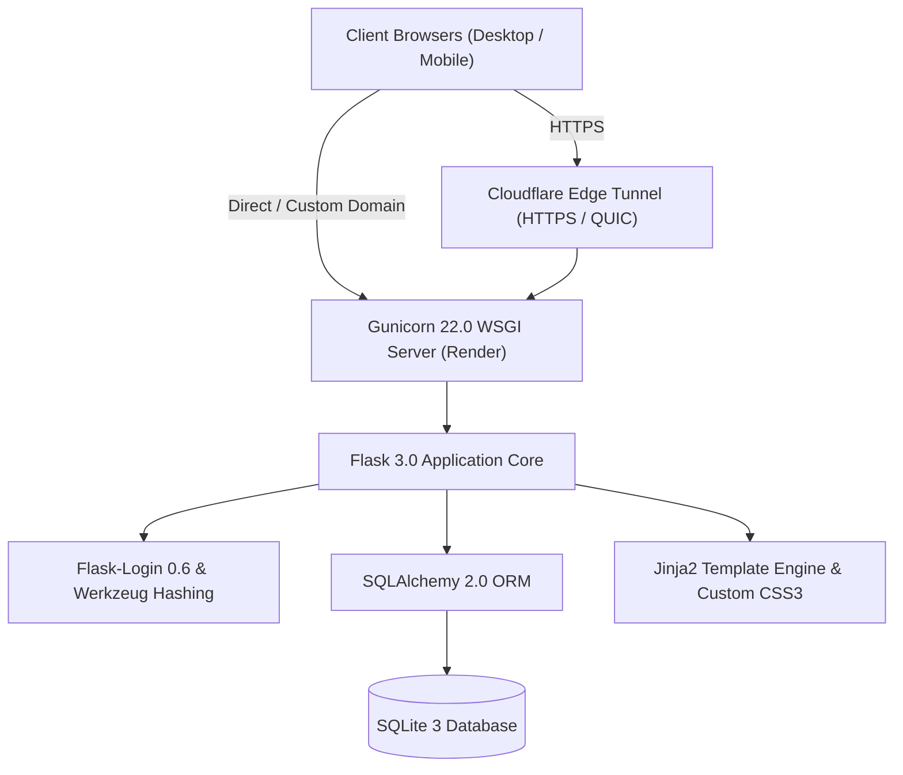
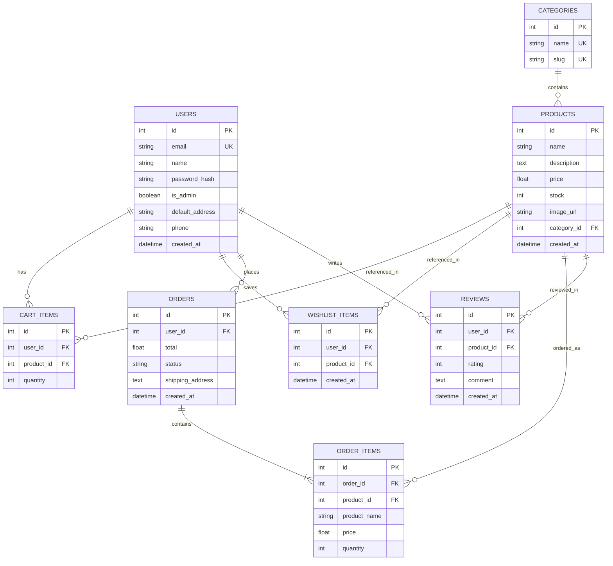

# 🛍️ ShopEasy — Full-Stack E-Commerce Platform
## Comprehensive Technical Project Report & Architectural Documentation

---

## 1. Executive Summary

**ShopEasy** is an enterprise-grade full-stack e-commerce web application developed using **Python (Flask 3.0)**, **SQLAlchemy 2.0 ORM**, **SQLite**, **Jinja2 templating**, and a responsive **CSS3 design system**. The platform is engineered to deliver an Amazon/Shopify-caliber shopping experience with sub-300ms page delivery, zero frontend framework build overhead, and complete operational transparency for store managers.

### Core Achievements
- **Customer Lifecycle**: End-to-end shopping journey including dynamic multi-attribute product search, multi-angle media galleries, interactive quick view dialogs, wishlist curation, promo voucher processing, address auto-completion, and order fulfillment tracking.
- **Enterprise Operations**: Centralized administrative dashboard displaying real-time financial KPIs (revenue, transaction volume, inventory levels), inline fulfillment state management, one-click inventory restock, and item creation.
- **Auditing & Compliance**: Dedicated official printable tax invoices (`INV-XXXXX`) styled with `@media print` directives for instant paper or PDF generation.
- **Accessibility & UX**: Native Dark/Light mode theme engine with `localStorage` state persistence, dismissible toast notifications, and mobile-first responsive grid layouts.
- **Cloud & WSGI Deployment**: Production-ready WSGI configuration with **Gunicorn**, containerized deployment on **Render**, and public zero-trust edge tunneling via **Cloudflare Tunnel**.

---

## 2. Technology Stack & Architecture

ShopEasy utilizes a modular Model-View-Template (MVT) monolithic architecture with strict separation of concerns across database persistence, business rules, routing, and UI presentation.



### Component Breakdown

| Layer | Technology | Version | Key Responsibilities |
|---|---|---|---|
| **Web Framework** | Flask | `3.0.0` | Routing, request context, sessions, context processors, error handling |
| **Database ORM** | Flask-SQLAlchemy | `3.1.1` | Declarative mapping, relationship cascading, transactional ACID operations |
| **Database** | SQLite 3 | `3.x` | Zero-configuration relational data storage |
| **Authentication** | Flask-Login & Werkzeug | `0.6.3` / `3.0.1` | Session persistence, cookie encryption, scrypt/PBKDF2 password hashing |
| **Production Server** | Gunicorn | `22.0.0` | Pre-fork worker process model for high-throughput WSGI serving |
| **Templating** | Jinja2 | `3.1.6` | Dynamic server-side rendering, layout inheritance, filters |
| **Frontend Styling** | Custom CSS3 | Modern | CSS Variables, Flexbox, CSS Grid, Glassmorphism, Print Media |
| **Cloud Hosting** | Render / Cloudflare | Production | Automated CI/CD git-push deployments, public edge tunneling |

---

## 3. Database Schema & Data Models

The relational database schema is structured to ensure referential integrity, eliminate duplicate records, and maintain historical auditability for completed orders.



### Key Data Modeling Highlights
1. **Immutable Order Line Snapshots**: `OrderItem` stores copies of `product_name` and `price` at the moment of checkout. If an administrator later alters a product's price or description, past customer receipts and accounting reports remain strictly accurate.
2. **Compound Unique Constraints**: `unique_cart_item` on `(user_id, product_id)` and `unique_wishlist_item` on `(user_id, product_id)` eliminate accidental duplicate rows at the database level.
3. **Cascading Deletion Rules**: Orphaned cart and wishlist entries are automatically cleaned up when parent records are modified.
4. **Dynamic Model Helpers**:
   - `Product.rating`: Aggregates real customer ratings with a calibrated baseline.
   - `Product.review_count`: Returns total verified purchaser submissions.
   - `Product.original_price`: Generates comparative anchor pricing for discount visualization.
   - `Product.gallery_images`: Supplies 4 distinct angle views (Front, Profile, Lifestyle, Detail) for the multi-angle viewer.
   - `User.total_spent`: Calculates cumulative customer lifetime value (LTV).

---

## 4. Key Modules & Functional Capabilities

### 4.1 Discovery & Catalog Experience
- **Live Search Autocomplete (`/api/search`)**: As the customer types, an asynchronous debounced query returns matching item thumbnails, categories, and prices directly in an overlay dropdown.
- **Multi-Faceted Filtering**: Filter by category slugs (`electronics`, `clothing`, `books`, `home`), budget ceilings (`Under $30`, `Under $50`, `Under $100`), and real-time inventory availability (`In Stock Only`).
- **Flexible Sorting**: Sort products by *Newest Arrivals*, *Price: Low to High*, *Price: High to Low*, or *Alphabetical (A-Z)*.
- **Quick View Modal**: Customers can inspect full specifications, ratings, descriptions, and trigger "Add to Cart" directly from catalog cards without navigating away.
- **Multi-Angle Gallery**: Product detail pages feature an interactive thumbnail gallery allowing customers to inspect front, side, in-use, and close-up views.

### 4.2 Cart, Promo Engine & Atomic Checkout
- **Smart Discount Engine**: Session-backed coupon engine supporting both percentage reductions and shipping fee waivers:
  - `WELCOME10`: 10% subtotal discount.
  - `SAVE20`: 20% promotional discount.
  - `FREESHIP`: Complete waiver of shipping fees.
- **Free Shipping Incentive Bar**: Real-time progress meter tracking remaining spending toward the $50 free shipping milestone.
- **Address Book Auto-Completion**: Pre-loads customer default shipping address from their profile to accelerate checkout completion.
- **Atomic Stock Management**: Checkout verifies stock levels, decrements inventory atomically, creates order records, and clears shopping carts inside a unified database transaction commit block.

### 4.3 Post-Purchase Fulfillment & Official Invoicing
- **Visual Milestone Tracker**: Order status visualized across 4 key stages: *Order Placed* → *Processing & Packing* → *In-Transit (Shipped)* → *Delivered*.
- **Official Tax Invoice (`/orders/<id>/invoice`)**: Clean printable billing receipt including company metadata, unique invoice identifiers, customer billing details, itemized totals, and zero-clutter `@media print` formatting.
- **Order History Filter Tabs**: Filter past purchases into *Pending*, *Processing*, *Shipped*, and *Delivered* buckets.

### 4.4 Verified Customer Reviews & Wishlist
- **Verified Customer Reviews**: Logged-in buyers can submit 1 to 5 star ratings and reviews. Verified purchaser badges enhance store credibility.
- **Wishlist Management (`/wishlist`)**: Quick heart toggle on cards and detail pages, with a dedicated page featuring one-click "Move to Cart" transitions.

### 4.5 Customer Profile & Account Center (`/profile`)
- Displays customer credentials, member tenure, total orders placed, and lifetime spend.
- Editable profile form allowing users to update their full name, contact phone number, and default delivery address.

### 4.6 Administrator Command Center (`/admin`)
- **Executive Analytics**: Real-time KPI summary displaying total store revenue, order volume, catalog size, and user registrations.
- **Fulfillment Operations**: Inline dropdown allowing administrators to update order fulfillment states (*Pending → Processing → Shipped → Delivered → Cancelled*).
- **One-Click Inventory Restock**: Quick `+15 Stock` button next to each product to immediately replenish stock levels.
- **Product Management**: Intuitive interface for adding new catalog items and deleting discontinued lines.

---

## 5. Security & Defensive Design

1. **Role-Based Access Control (RBAC)**: All administrative routes are gated by the custom `@admin_required` decorator, terminating unauthorized attempts with HTTP 403 Forbidden.
2. **Horizontal Privilege Enforcement (IDOR Protection)**: User cart manipulations, order details, invoices, and profile modifications verify that `record.user_id == current_user.id`.
3. **Cryptographic Credential Hashing**: User passwords are encrypted with `Werkzeug`'s industry-standard salted hashing algorithms; plaintext passwords are never stored.
4. **Input Validation**: Text length validation, email format checking, and type casting prevent unexpected input states.
5. **Session Safety**: Flask session cookies are signed with an environment-driven `SECRET_KEY`.

---

## 6. Deployment Pipeline & Cloud Infrastructure

### Local Development
```bash
# 1. Virtual Environment
python -m venv venv
venv\Scripts\activate

# 2. Dependencies
pip install -r requirements.txt

# 3. Execution
python app.py
# Server running at http://localhost:5000
```

### Production Deployment on Render
1. **Repository**: Code pushed to [github.com/jaspalthakur/ecommerce_store](https://github.com/jaspalthakur/ecommerce_store).
2. **Build Configuration**: Render executes `pip install -r requirements.txt`.
3. **Execution Command**: Triggered via `Procfile` (`web: gunicorn app:app`).
4. **Startup Hook**: Database schema creation and initial demo seeding are triggered automatically within `app.app_context()` when Gunicorn initializes.

### Edge Public Tunnel (Cloudflare)
Cloudflare Tunnel runs as a zero-trust reverse proxy forwarding traffic from `http://127.0.0.1:5000` to a globally accessible public HTTPS endpoint, enabling instant mobile and stakeholder review without opening firewall ports.

---

## 7. Deliverables & Resource Index

| Deliverable | Path / Link | Description |
|---|---|---|
| **PowerPoint Slide Deck** | [`ShopEasy_Project_Presentation.pptx`](file:///d:/Projects/ecommerce_store/ShopEasy_Project_Presentation.pptx) | 10-slide 16:9 widescreen presentation file |
| **Interactive Web Slides** | [`presentation_slides.html`](file:///d:/Projects/ecommerce_store/presentation_slides.html) | Browser-based slide deck with keyboard controls |
| **Slide Route** | `http://localhost:5000/slides` | Web presentation view directly inside the Flask app |
| **Technical Report** | [`PROJECT_REPORT.md`](file:///d:/Projects/ecommerce_store/PROJECT_REPORT.md) | Markdown project and architectural report |
| **GitHub Repository** | [github.com/jaspalthakur/ecommerce_store](https://github.com/jaspalthakur/ecommerce_store) | Full source code with commit history |

---

## 8. Future Roadmap

1. **Payment Gateway**: Integration with Stripe / Razorpay Webhooks for live credit card and digital wallet settlement.
2. **Relational Scaling**: Transition from SQLite to PostgreSQL with connection pooling for enterprise concurrent workloads.
3. **Automated Notifications**: Email confirmation dispatch via SendGrid or AWS SES upon order placement and fulfillment status updates.
4. **Mobile API Layer**: Headless RESTful / GraphQL API endpoints enabling native iOS/Android mobile clients.
